# Make LiquidityMapperFast yours: layouts, backups and your own theme

LiquidityMapperFast remembers how you set it up, in your browser. This guide shows the three ways to keep and move that setup:

1. **Layouts**: name an arrangement of the panels, with the chart's settings, and switch between several.
2. **Back up and restore**: put *everything* in one file, and open it in another browser or on another computer.
3. **Your own theme**: start from any theme and change its colours, live.

Nothing here needs an account or a server. It all stays in your browser until you write a file yourself.

---

## 1. Layouts

A layout is a picture of your screen: which panels are open, where they stand, how big they are, and (by default) every setting of the chart: the timeframe, the heatmap colours, the footprint, VWAP, volume profile, and every other switch.

**Open the Layouts panel** with the first button in the map's top corner (on a tablet: **Settings → Layouts**).

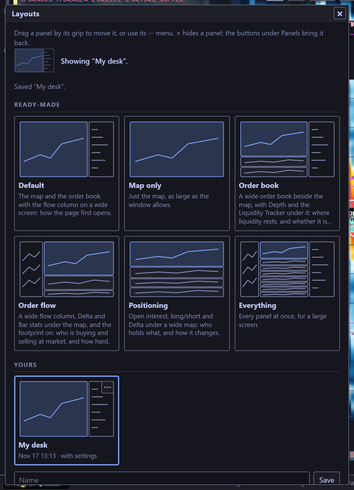

- **Ready-made**: six arrangements to start from (Default, Map only, Order book, Order flow, Positioning, Everything). They change the panels only: your colours, timeframe and venues stay as they are.
- **Yours**: the layouts you saved. Click a card to apply it. Its small print says when it was saved and whether it keeps **with settings** or **panels only**.

### Save a layout

1. Arrange the panels the way you like them, and set the chart up (timeframe, footprint, VWAP, ...).
2. Type a name in the **Name** box at the bottom of the panel and press **Save** (or Enter).

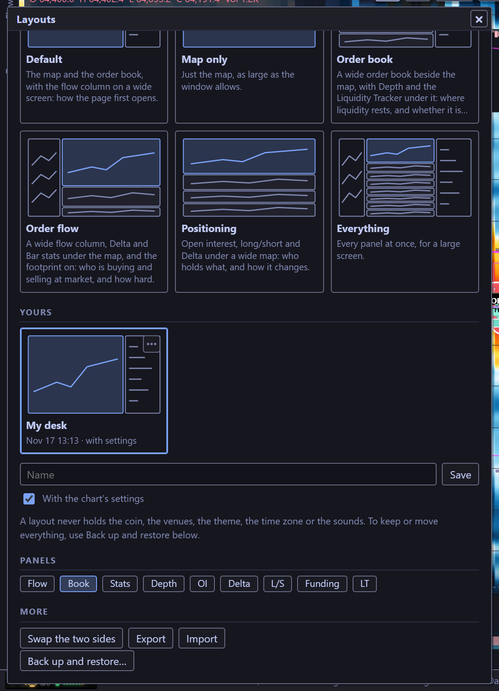

**With the chart's settings** is ticked for you: the layout then brings back the whole chart, not just the panels. Clear it if you want a layout that only moves panels around and leaves your chart settings alone.

Saving under a name that is already there replaces that layout. The **⋯** on each of your cards can **Update** it with what is on the screen now, **Rename**, **Duplicate** or **Delete** it. Applying a layout, hiding a panel or deleting a layout offers **Undo** for a few seconds.

### What a layout does not hold

A layout never changes the **coin**, the **venues**, the **theme**, the **time zone** or the **sounds**, so applying one never moves you to another market or another look. To keep or move those too, use **Back up and restore** (next section).

> **Export / Import** (under *More* in the Layouts panel) write your layouts to a file and read them back, for example to share a layout with a friend. To move *everything*, use a backup instead.

On a phone the panels are tabs, so there is no Layouts panel; a backup still carries your settings.

---

## 2. Back up and restore

A backup is one file with everything the page keeps in your browser:

- your settings (every switch, the timeframe, the heatmap colours, the theme, the language, the time zone, the sounds),
- your layouts,
- your scripts,
- your drawings,
- your own themes,
- the coin and the venues you chose.

It does not hold the recorded market history: the page records that again as it runs.

**Where to find it**

- On a computer: **Layouts panel → Back up and restore…** (the last button).
- On a phone: **⋯ (Settings) → Tools → Back up and restore**.
- On a tablet: **Settings → Layouts → Back up and restore**.

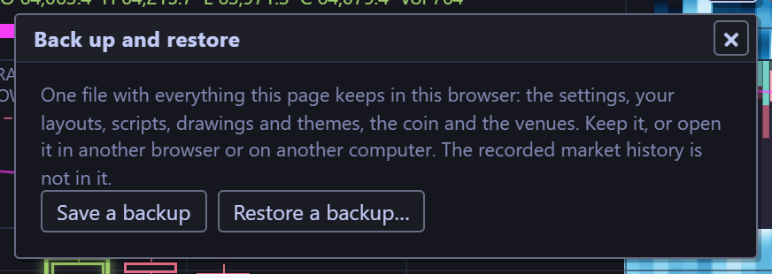

### Save a backup

Press **Save a backup**. Your browser saves a file named like `liquiditymapperfast-backup-2026-11-17.json`. The panel says what went into it (for example *1 layout, 1 theme, the settings*).

Good moments to save one: before trying many changes, before clearing your browser's data, and before moving to a new computer.

### Restore a backup

1. Open **Back up and restore** in the browser you want to set up (another browser, another computer, or this one after a reset).
2. Press **Restore a backup…** and choose the file.
3. The panel tells you when the backup was saved and what it holds, and asks before it changes anything:

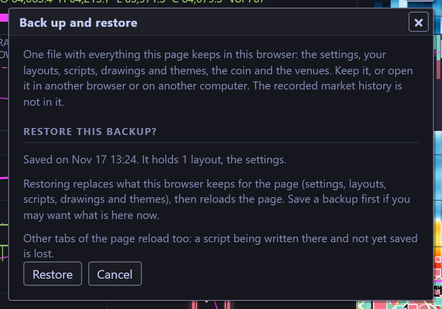

4. Press **Restore**. The page reloads with your setup, and a message says *The backup was restored.* Press **Cancel** to leave everything as it is.

Restoring **replaces** what this browser holds for the page: layouts, scripts, drawings and themes that are only here and not in the file are gone afterwards. If you might want them, save a backup of this browser first.

Other tabs of the page that are open in this browser reload too, so they show the restored setup and cannot write their old one back. A script you were writing in another tab and had not saved yet is lost, so save it first.

If you pick a layouts, themes or scripts file by mistake, the panel tells you where that file is read instead.

---

## 3. Your own theme

The theme menu has more than twenty themes. You can also make your own: start from any of them and change any colour, and watch the whole page follow as you pick.

### Start a theme

1. Open the **theme menu**: on a computer, the theme button at the right end of the status bar (it shows the theme's name and colours); on a phone, **⋯ (Settings) → Appearance → Theme**.
2. Choose the last row, **Make your own…**

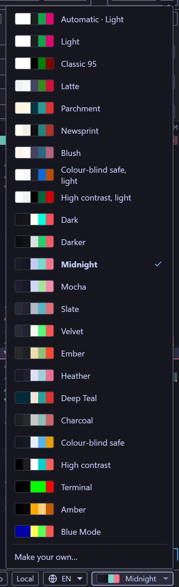

3. Press **Copy "…" and edit it**. Your theme starts as an exact copy of the theme on the screen, so pick the built-in theme closest to what you want first.

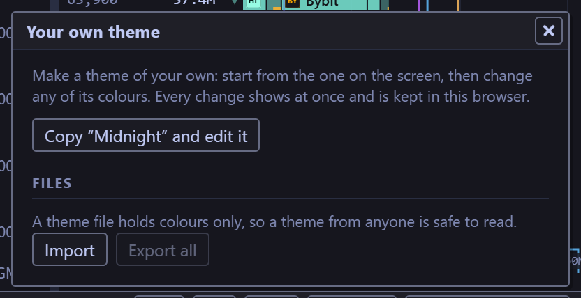

### Change it

Your theme is now the page's theme, and the panel shows everything you can change:

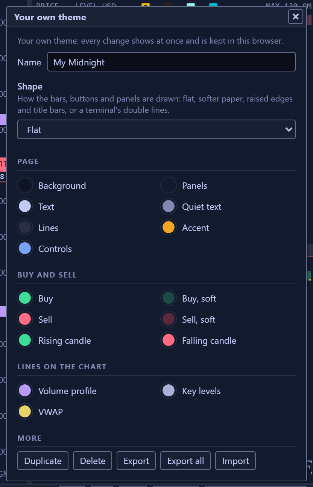

- **Name**: what the theme menu calls it.
- **Shape**: how bars, buttons and panels are drawn: **Flat**, **Paper** (softer), **Raised, like a 1990s desktop**, or **Text mode** (a terminal look).
- **Page**: the background, the panels, the text, the quiet text (labels and second lines), the lines, the accent and the controls (switches and chosen buttons).
- **Buy and sell**: the buy and sell colours, their soft shades (fills in the book and the flow), and the rising and falling candles.
- **Lines on the chart**: the volume profile, the key levels and the VWAP.

Click a colour dot to open your system's colour picker. The page changes **while you pick**, and the colour is kept when the picker closes. There is no Save button: every change is kept in this browser at once.

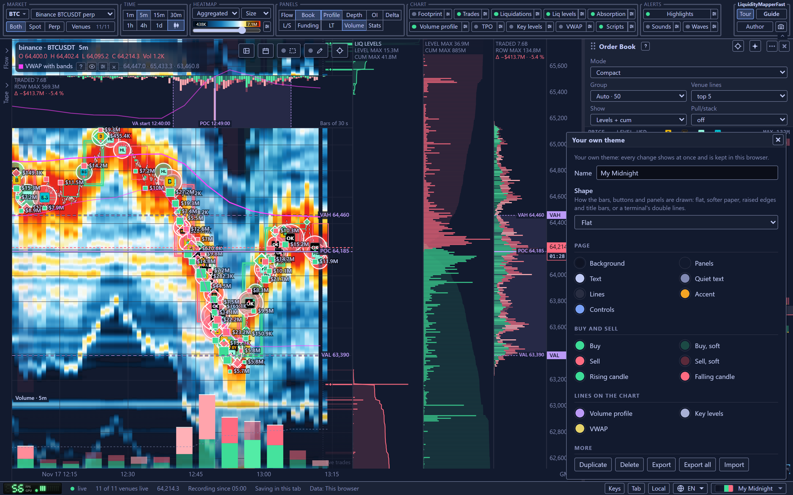

### Readable whatever you choose

You cannot make the page unreadable by accident. If the text or quiet text you pick would not read on your background and panels, the page draws them a little lighter or darker and says so. Colours that will be hard to see (a VWAP colour too close to the background, buy and sell that look alike) are named under the colours, so you can fix them:

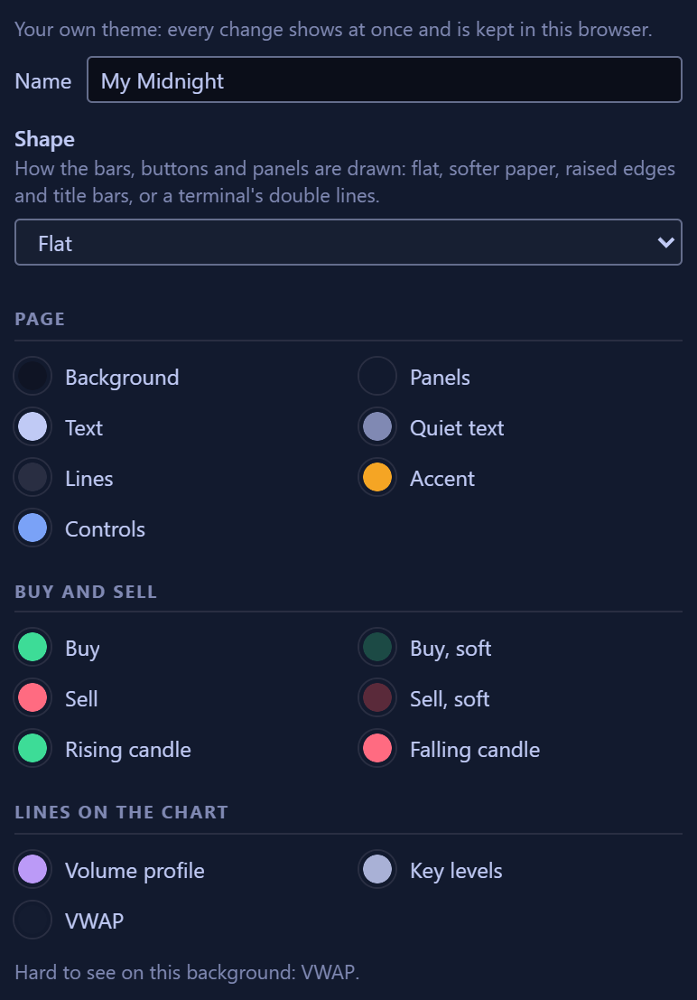

### Later

- To edit your theme again, choose it in the theme menu, then **Edit this theme…** (the menu's last row).
- **Duplicate** makes a copy to try something else; **Delete** removes it (the message that follows can bring it back) and the page goes back to the Light or Dark theme.
- The **light-or-dark key** on a phone's top bar switches between your last light and your last dark theme, yours included.
- Candle colours of your own (**Chart type → Candle colours**) still win over the theme's rising and falling candle, as before.

### Share a theme

- **Export** writes the theme on the screen to a small file; **Export all** writes all of yours.
- **Import** reads a theme file. A theme of the same name is replaced; the first theme read is shown.

A theme file holds **colours only**: no code, styles, fonts or pictures. So a theme someone shares with you is safe to import: the worst it can do is look bad, and **Delete** fixes that.

---

## On a phone

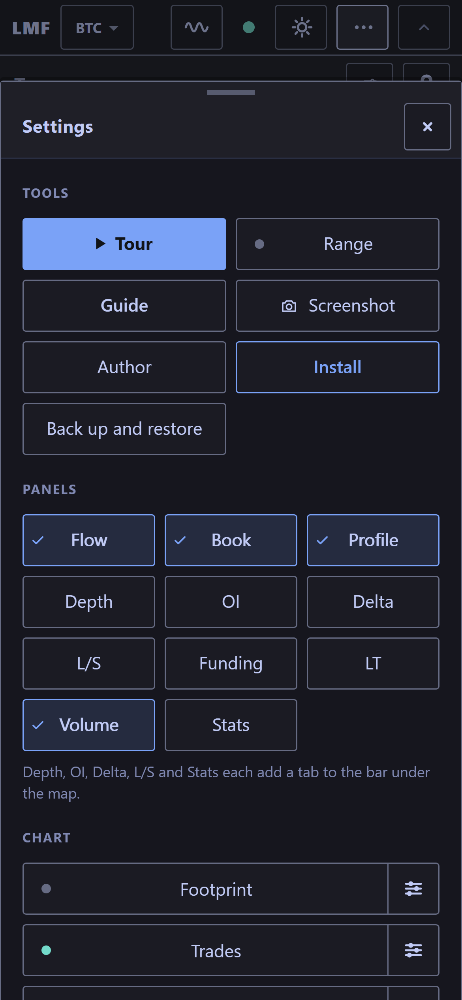

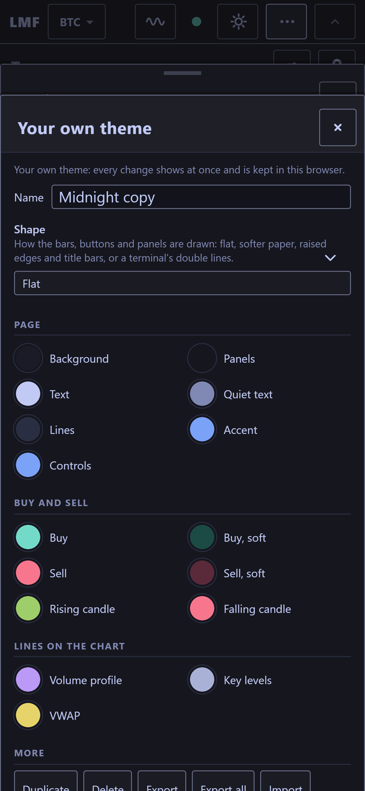

Everything above works the same on a phone: **⋯ (Settings) → Tools → Back up and restore**, and **⋯ (Settings) → Appearance → Theme → Make your own…**. A backup saved on a computer can be restored on a phone and the other way round. Layouts stay on the computer, since a phone shows panels as tabs.

---

## Questions

**Where is my setup kept?** In this browser's storage for liquiditymapper.com. Another browser, a private window or another computer starts fresh until you restore a backup there.

**Will clearing my browser's data remove it?** Yes: clearing site data removes layouts, scripts, drawings, themes and settings. Save a backup first.

**Can I edit a backup or theme file by hand?** Yes, they are plain JSON. A colour must be written `#rrggbb`. Anything the page cannot read is skipped or replaced by the theme's own colour, so a broken file cannot break the page.
